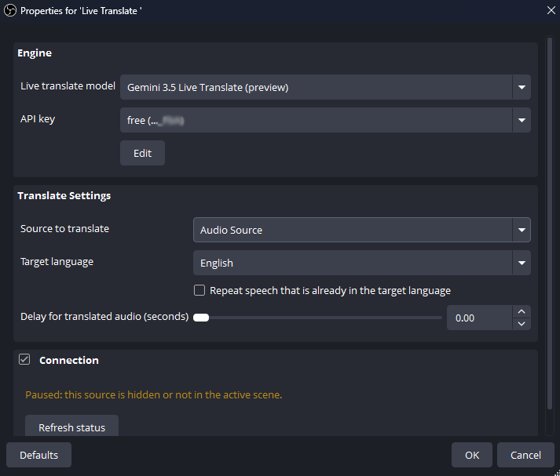
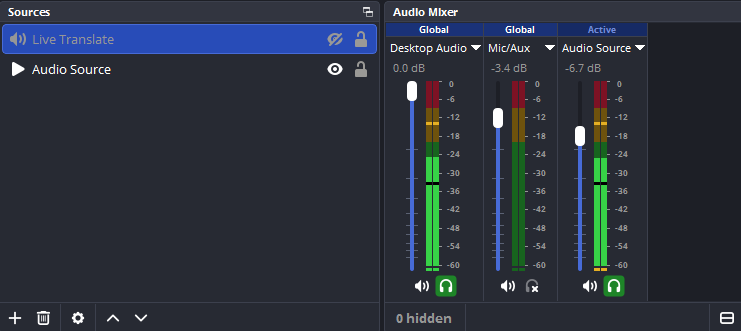

<p align="center">
  <picture>
    <source media="(prefers-color-scheme: dark)" srcset="media/icon-light.png">
    
  </picture>
</p>

# Vila GLT — Live Translate (`obs-vila-glt`)

**English** · [Srpski](README.sr.md)

[](LICENSE)

A native OBS Studio plugin that does real-time **speech-to-speech** translation
using the Google **Gemini Live API** (`gemini-3.5-live-translate-preview`). It
captures the audio of any OBS source — a microphone, a browser source, a media
source — streams it to Gemini, and plays the translated speech back as a
separate OBS audio source, so a stream/recording can carry both the original
voice and a live translation. Several sources can be translated at once.

The plugin is part of **Vila**, a system of voice tools and agents built on
Google's Gemini Live models (native audio and live translate); *GLT* stands
for *Gemini Live Translate*. It brings Vila's live translation into OBS Studio.

> **Fork & Attribution:** `obs-vila-glt` is a fork of
> [weisunglee/obs-live-translate](https://github.com/weisunglee/obs-live-translate)
> (*Gemini Live Translate for OBS*, v0.1.6, by **Only26k / weisunglee**),
> redesigned for broadcast production: the original's microphone filter +
> singleton architecture is replaced by independent per-source translation
> sessions, API keys are stored outside the scene collection in `.env`, the
> model/language catalog is driven by JSON, and sessions auto-reconnect on
> transient drops or auto-hide their scene item on fatal errors.
>
> **Windows only.** Releases ship a Windows installer and zip; the macOS and
> Linux build files inherited from the original are kept but untested. An
> independent project, not affiliated with or endorsed by the OBS Project or
> Google.

> [!IMPORTANT]
> **AI-assisted development.** A substantial part of this fork's code and
> documentation was written with AI coding assistants (Claude Code, Google
> Antigravity), under the maintainer's direction; the original project's code
> it builds on is its author's. The design and every decision are the
> maintainer's. Each release is built, passes the unit tests, and is tested by
> the maintainer in a live OBS setup before it is published.

**Download:** the Windows installer and a drop-in zip are on the
[Releases page](https://github.com/nklisic/obs-vila-glt/releases/latest) — no
need to download the source.

## How it works

The plugin registers one OBS source, **Live Translate** *(audio
source)*. Add one per audio source you want translated and pick that source as
its **Source to translate** — a microphone, a browser source, a media source, any
OBS source that produces audio.

It taps the input's audio (after the input's own filters, before its fader, so
lowering the original in the mixer does not change what Gemini hears), resamples
it to 16 kHz mono 16-bit PCM, chunks it (100 ms / 3200-byte chunks), and streams
it **continuously** to Gemini over a TLS WebSocket — including the silence
during pauses, which the model relies on to detect when an utterance ends and
emit its translation promptly. The 24 kHz translated PCM that comes back is
pushed into the OBS mixer as this source's own audio. Configure the **input**,
**API key**, **target language**, **echo** option, and optional **playback
delay** in its properties.

```
input audio source (mic, browser, media, …)
   │ audio capture callback (post-filter, pre-fader; original is untouched)
   ▼
[Live Translate source]
   resample 16 kHz mono → chunk → WebSocket ─▶ Gemini Live API
                                                   │ 24 kHz PCM
   event-driven push loop ◀── ring buffer ◀────────┘
   → obs_source_output_audio → OBS mixer
```

Each source owns its own `TranslationSession` — the WebSocket connection (with
reconnect/backoff) and the input/output audio buffers — so several sources can
translate different inputs side by side. The output path pushes
every received PCM chunk to OBS with contiguous, duration-spaced timestamps,
paced so the scheduling lead stays bounded (~600 ms, enough to ride out the
model's phrase-boundary delivery jitter) — the OBS mixer is the clock.

## Getting a Gemini API key

The plugin needs a Google **Gemini API key**:

1. Sign in to **Google AI Studio** at <https://aistudio.google.com/apikey> with
   a Google account.
2. New users: AI Studio creates a default Google Cloud project and key
   automatically once you accept the Terms of Service. Otherwise click
   **Create API key**.
3. In the properties of any *Live Translate* source, section **Engine**, click
   **Edit**, paste the key into *New API key* and click **Save**. The *API key*
   list then shows it as *default (...xxxx)* — only the last four characters.
   The key is shared by all sources.

   To keep several keys, type a **Key name** before saving (e.g. `studio`); each
   source then picks its key in the *API key* list. **Edit** → **Remove**
   deletes the selected key.

Notes:

- The key is **not** stored in the scene collection. It is saved as
  `GEMINI_API_KEY=...` in a `.env` file in the OBS config folder
  (`%APPDATA%\obs-studio\.env` on Windows, `~/.config/obs-studio/.env` on Linux,
  `~/Library/Application Support/obs-studio/.env` on macOS). It is never put
  back into the properties and cannot be read or set through OBS WebSocket. The
  keys serve every source in every scene collection; the model table names the
  variable each model uses, and named keys are stored as variants of it
  (`GEMINI_API_KEY_STUDIO=...`).
- The `.env` file is **plain text**, the same on every platform — protect it
  like a password file (on Linux/macOS it is created readable by you only). You
  can also create or edit it by hand; it is read when OBS starts. Other
  variables in the file are left untouched.
- This guards against leaking the key by sharing scenes or through OBS
  WebSocket; it does not stop anyone who can read your OBS config folder.
- A scene collection saved by an older version of the plugin still contains the
  key in plaintext (also in OBS's `.bak` copies) until it is saved again; on
  load that key is moved to the `.env` file if none is stored yet.
- `gemini-3.5-live-translate-preview` usage is billed per Google's pricing;
  check current quotas and pricing in AI Studio
  ([pricing](https://ai.google.dev/gemini-api/docs/pricing)).

## Status

Works on **Windows** (the only platform this fork is built and tested on) with
**OBS Studio 33 or newer** (tested on 33.0.1). It installs into the plugin
location OBS introduced in 33.0, which older versions do not read. Current
behavior:

- ✅ Any audio source → Gemini streaming (continuous, including pause silence),
  translated audio played back via the OBS mixer.
- ✅ Reconnect on transient WebSocket drops and rate limits, following Google's
  error guidance: a session that ran for at least 30 s reconnects immediately
  when it drops; other failures (including a session that drops again soon
  after connecting) back off 1-16 s and stop after 5 attempts. Errors that
  cannot succeed on retry (credits used up, invalid API key, unknown model or
  unsupported setup) stop immediately. Live API-key / target-language changes.
- ✅ Event-driven push output with a bounded scheduling lead (~600 ms) to ride
  out the model's phrase-boundary delivery jitter.
- ✅ **Live translate model** list, driven by [`data/models.json`](data/models.json)
  (see *Models and languages*).
- ✅ Optional **Repeat speech that is already in the target language** (echo,
  default off): with it off, input already in the target language stays silent;
  with it on, the model repeats it.
- ✅ Optional **Delay for translated audio** (0-30 seconds): hold the translated
  audio so every translated phrase plays later by the configured amount. The
  original is never delayed. Only useful when the picture is delayed too.
- ✅ Sentence endings play in full — streaming the mic continuously (silence
  included) lets the model detect when an utterance ends and emit it promptly,
  instead of holding it until the next one starts.
- ✅ One translation stream per *Live Translate* source. Add several to
  translate several inputs at once (e.g. a host plus guests in different
  languages); each has its own connection, language and settings. Other
  *Live Translate* sources are not offered as inputs, so a translation
  is never translated again.
- ✅ A *Live Translate* source **cannot be duplicated**: a copy would open a
  second, separately billed session for the same input. *Paste (Reference)*
  and duplicated scenes share the one source; for another input or language
  add a new *Live Translate* source with **+**.
- ✅ The **Connection** section's checkbox switches the session on and off by
  hand (on by default); its status line is coloured by severity and has a
  **Refresh status** button, since OBS does not refresh open properties itself.
- ✅ The *Source to translate* list offers the sources shown in the OBS Audio
  Mixer (audio actually active), so a camera whose microphone is disabled is
  not listed.
- ✅ Interface texts are localized (`data/locale`): English, Serbian (Latin
  and Cyrillic), Bulgarian, Greek, Romanian, Hungarian, Slovak, Russian, Thai
  and Filipino; the
  plugin follows OBS's interface language and falls back to English without the
  locale files. Translations other than English and Serbian are machine-made
  — corrections from native speakers are welcome.
- ✅ Hiding the source also stops it. A session only runs while its *Live
  Translate* source is active in the program: hide it (eye icon, or an
  OBS show/hide hotkey) or switch to a scene without it and the connection is
  closed, so nothing is streamed to Gemini. Showing it again reconnects, which
  takes about a second. Conversely, if a session stops on a fatal error (no
  credits/quota, invalid key) or after all 5 reconnect attempts fail, it
  automatically hides itself in every scene where it appears, groups included
  (turns the eye icon off), while keeping the error message visible in its
  properties.
- ✅ A muted input is sent as silence, so muting the original also stops its
  translation. Lowering the input's fader does not affect the translation.
- ⚠️ The translated audio lags your speech by a few seconds — the model's
  translation latency plus a fixed ~600 ms smoothing buffer (which doesn't
  accumulate; measured backlog stays <50 ms). Tip: when **recording**, pause a
  beat after your last sentence before hitting stop so the trailing translation
  is captured. **Live streams** aren't affected.

## Known limitations

Most of these come from the Gemini model, which is a **preview**, not from the
plugin.

- **Sessions last about 10 minutes.** The server ends each session after ~10
  minutes; the plugin reconnects at once (the gap is a fraction of a second).
- **The translator's voice can shift.** For the first seconds of every new
  session the voice is not yet settled, so it can change slightly about every
  10 minutes. After a change of speaker the voice may also keep the previous
  speaker's gender (e.g. stay male while a woman is speaking again). Fast,
  animated speakers make this worse.
- **Songs are translated too.** Lyrics sung over music are translated like
  speech. Hide the *Live Translate* source during songs.
- **Free-tier API keys** get disconnected by the server more often than paid
  ones, and each reconnect starts a new session (see the voice note above).
- **Network outages:** a dropped connection is noticed after roughly 10–20 s,
  then the plugin retries for about 15 s more. A shorter outage recovers on its
  own; a longer one stops the translation and hides the source — show it again
  once the network is back.
- **Billing follows the time a session is open**, silence and music included.
  Hiding the source closes the session and stops the cost. Check current
  prices in [Google's pricing](https://ai.google.dev/gemini-api/docs/pricing).
- **Browser sources** are only offered as input when *Control audio via OBS* is
  on in their properties — otherwise their sound bypasses OBS entirely.
- **Desktop Audio as input** can capture the monitored translation itself and
  loop. Pick the actual source (media, browser, microphone) instead.
- **The installer is not code-signed**, so Windows SmartScreen may warn before
  running it.

## Install

Requires **OBS Studio 33 or newer**. The plugin goes into the location OBS
uses for third-party plugins since 33.0
([OBS knowledge base](https://obsproject.com/kb/legacy-plugin-developer-info)):

```
C:\ProgramData\obs-studio\plugins\obs-vila-glt\obs-vila-glt.dll
C:\ProgramData\obs-studio\plugins\obs-vila-glt\data\   (models.json, locale\, icon.ico)
```

**Installer (recommended):** download
`obs-vila-glt-<version>-windows-x64-installer.exe` from the
[Releases page](https://github.com/nklisic/obs-vila-glt/releases/latest) and
run it with OBS closed. It needs administrator rights, refuses OBS versions
older than 33, and removes copies left by earlier versions in OBS's own folder
(`C:\Program Files\obs-studio\…`, a "Legacy" location that OBS 34 will no
longer load). It is uninstalled from Windows *Apps*.

**Zip, by hand:** download `obs-vila-glt-<version>-windows-x64.zip`, close OBS
and copy its `obs-vila-glt` folder into `C:\ProgramData\obs-studio\plugins\`.

**Where OBS is installed does not matter** — OBS reads third-party plugins from
the system ProgramData folder, wherever OBS itself lives. Two special cases:

- **OBS from Steam:** the installer may not find OBS and asks *Install
  anyway?* — choose **Yes**; Steam's OBS loads plugins from ProgramData too.
- **Portable OBS** ignores ProgramData. Use the zip and copy its
  `obs-vila-glt` folder into `<your OBS folder>\plugins\` (create `plugins`
  if needed).

**From your own build** (see *Build from source*): compile the Inno Setup 7
script with `ISCC /Obuild_x64\installer installer\obs-vila-glt.iss`, or with
OBS closed copy `build_x64\RelWithDebInfo\obs-vila-glt.dll` to
`C:\ProgramData\obs-studio\plugins\obs-vila-glt\` and the `data\` folder to
`C:\ProgramData\obs-studio\plugins\obs-vila-glt\data\`.

The DLL alone also works: the interface then falls back to English and the model
table to the copy embedded in the DLL.

> Note: Since `obs-vila-glt` uses its own module filename (`obs-vila-glt.dll`), do not keep the upstream `obs-live-translate.dll` installed at the same time, as both register the `gemini_translated_audio_source` source ID.

## Usage

1. Add a **Live Translate** source to your scene (Sources → **+** →
   *Live Translate*).

2. In its properties:
   - **Engine** — pick the **Live translate model** and set the API key once
     (**Edit**).
   - **Translate Settings** — pick the **Source to translate** and the **Target
     language**; optionally *Repeat speech that is already in the target
     language* and *Delay for translated audio*.
   - **Connection** — leave it switched on. Once it connects the status reads
     *Connected* (use **Refresh status**).

   <p align="center">
     
   </p>

3. The source plays the translated voice. Mix it against the original in the
   OBS mixer (e.g. lower the original under the translation for a voice-over),
   or route it to its own track in *Advanced Audio Properties*.

Repeat for every audio source you want translated.

The eye icon in the Sources list switches the translation: a hidden source (or
one not in the active scene) is paused and has no open session, so nothing is
billed; showing it again connects in under a second. The translation appears in
the Audio Mixer as its own channel only while it is active.

<p align="center">
  
  
</p>

## Remote control (OBS WebSocket)

The source's settings are plain OBS source settings, so you can change the
**target language**, **echo** option, and **playback delay** live from any OBS WebSocket v5 client
(scripts, [`obs-cli`](https://github.com/muesli/obs-cli), Advanced Scene
Switcher, your own app) using the `SetInputSettings` request — no extra
plugin support needed:

```json
{ "requestType": "SetInputSettings",
  "requestData": {
    "inputName": "Live Translate",
    "inputSettings": { "target_lang": "ja" } } }
```

| setting | type | meaning |
|---|---|---|
| `input_source` | string | UUID of the OBS source to translate (empty stops the session) |
| `model` | string | model `id` from [`data/models.json`](data/models.json) |
| `target_lang` | string | the language's `code` from [`data/models.json`](data/models.json), not its `name` — e.g. `sr`, not `Српски (Serbian)` |
| `echo_target` | bool | repeat speech that is already in the target language |
| `playback_delay` | number | seconds to delay the translated audio stream, clamped to 0-30 |
| `enabled` | bool | the Connection switch: `false` closes the session, `true` reconnects |
| `api_key_name` | string | which stored key to use: the `.env` variable name of a named key, or empty for the default one |

Notes:

- `inputName` must match your OBS source name exactly.
- Changing `model`, `target_lang` or `echo_target` reconnects the session, so
  expect a brief gap. Changing `input_source` or `playback_delay` does not.
- The API key cannot be set or read this way; use the properties or the `.env`
  file.
- This is **set-only**. The runtime connection status (Connecting / Connected /
  API-key error) is not exposed over WebSocket — `GetInputSettings`
  returns the stored settings, not the live status.

## Models and languages

The **Live translate model** list and each model's languages come from
[`data/models.json`](data/models.json). The file is embedded into the plugin
when it is built, so the plugin works as a single binary.

```json
{ "models": [ {
    "id": "gemini-3.5-live-translate-preview",
    "name": "Gemini 3.5 Live Translate (preview)",
    "provider": "gemini",
    "api_key_env": "GEMINI_API_KEY",
    "supports_echo": true,
    "languages": [ { "code": "en", "name": "English" } ]
} ] }
```

To add or change a model without rebuilding, put a `models.json` of the same
shape into `plugin_config/obs-vila-glt/` in the OBS config folder: a model
with an existing `id` replaces the built-in one, new ids are added. It is read
when OBS starts.

`provider` selects the protocol the plugin speaks. Only `gemini` is implemented;
a row with another provider is skipped until that protocol is added in code.
`api_key_env` is the variable in the `.env` file that holds that model's key.

## Build from source

Requires CMake ≥ 3.28 and a C++17 toolchain. Dependencies (nlohmann/json,
IXWebSocket + mbedTLS) are fetched by CMake; libobs/obs-deps come from
`buildspec.json` on Windows/macOS and from the system on Linux.

Warnings: the plugin and the unit tests build at `/W4` (`-Wall -Wextra`
elsewhere) with warnings as errors. Third-party code is excluded — its headers
are included as external, and IXWebSocket's own sources are compiled with
warnings off — so any warning in the build log comes from our code and must be
fixed. On macOS/Linux this stricter setup is untested; there the
`-DCMAKE_COMPILE_WARNING_AS_ERROR=OFF` flag below keeps a warning from
failing the build.

**Windows** (Visual Studio 2022) — produces `build_x64\RelWithDebInfo\obs-vila-glt.dll`:

```powershell
cmake --preset windows-x64
cmake --build --preset windows-x64
```

**macOS** (Xcode 16+, universal) — produces `build_macos/RelWithDebInfo/obs-vila-glt.plugin`:

```bash
cmake --preset macos -DCMAKE_COMPILE_WARNING_AS_ERROR=OFF
cmake --build --preset macos --target obs-vila-glt
```

**Linux** — libobs comes from the obsproject PPA; install build deps first:

```bash
sudo add-apt-repository --yes ppa:obsproject/obs-studio
sudo apt-get update
sudo apt-get install -y obs-studio libsimde-dev libmbedtls-dev cmake ninja-build pkg-config
cmake --preset ubuntu-x86_64 -DCMAKE_COMPILE_WARNING_AS_ERROR=OFF
cmake --build --preset ubuntu-x86_64 --target obs-vila-glt   # build_x86_64/obs-vila-glt.so
```

(The Windows release steps live in [`.github/workflows/release.yaml`](.github/workflows/release.yaml);
CI does not build macOS or Linux.)

## Test

Use your platform's build directory (`build_x64` on Windows, `build_macos` on
macOS, `build_x86_64` on Linux). For example, on Windows:

```bash
# Build the libobs-free unit-test binary first
cmake --build --preset windows-x64 --target unit-tests

# Run the full unit-test suite
ctest --test-dir build_x64 --output-on-failure

# Run a single test case by name
ctest --test-dir build_x64 -R "<test case name>" --output-on-failure
```

The `unit-tests` target covers the pure logic (base64, ring buffer, backoff,
audio conversion, audio pacing/timestamper, output delay, `.env` handling,
model catalog, session start/reconnect rules, reconnect policy, Gemini
protocol parsing and disconnect classification) and does **not** require libobs. Code that touches
libobs (`source.cpp`, `translation-session.*`) is verified by the full plugin
build and by testing in OBS.

## Project layout

```
src/
  plugin-main.cpp        module entry; registers the source
  source.cpp             translated-audio source: input capture (resample →
                         chunk → stream) + event-driven output push loop
  translation-session.*  per-source WebSocket session + audio buffers + reconnect
  session-config.*       when a session runs / needs to reconnect
  model-catalog.*        parses/merges the model + language table
  model-store.*          loads the catalog (embedded JSON + optional overrides)
  api-key.*              API keys per provider, kept in <OBS config>/.env
  dotenv.*               minimal .env reading/editing
  live-protocol.*        build/parse Gemini Live API messages; classify disconnects
  audio-pacing.*         OutputTimestamper (contiguous, lead-bounded timestamps)
  output-delay.*         optional playback delay for the translated audio
  audio-convert.*        PCM downmix / conversion / chunking
  ring-buffer.*          bounded byte ring buffer
  backoff.*              exponential reconnect backoff
  reconnect-policy.*     when to reconnect, wait or give up after a disconnect
  base64.*
tests/                   Catch2 unit tests (one per pure module)
data/                    models.json + locale/ (en-US, sr-CS, sr-SP, bg-BG,
                         el-GR, ro-RO, hu-HU, sk-SK, ru-RU, th-TH, fil-PH)
media/                   project icon (README, installer); the OBS Sources
                         list currently shows OBS's built-in speaker icon
installer/               Inno Setup 7 script for the Windows installer
tools/build-icons.py     regenerates media/icon.png, icon-light.png, icon.ico
cmake/, CMakePresets.json, buildspec.json
```

## Tech stack

C++17 · CMake (obs-plugintemplate) · libobs (OBS 31.1.1 SDK) · IXWebSocket (TLS via
mbedTLS) · nlohmann/json · Catch2.

## Key API facts

- Model: `models/gemini-3.5-live-translate-preview` over a TLS WebSocket.
- **Input** to Gemini: 16 kHz, 16-bit PCM, mono, little-endian, 100 ms chunks.
- **Output** from Gemini: 24 kHz, 16-bit PCM, mono.
- `translationConfig` takes `targetLanguageCode` (BCP-47) and
  `echoTargetLanguage`; there is **no source-language parameter** — the model
  auto-detects the spoken language.

## Supported languages

The **target language** dropdown offers the languages
`gemini-3.5-live-translate-preview` supports (from the
[official Live Translate docs](https://ai.google.dev/gemini-api/docs/live-api/live-translate)),
each labelled with its native name plus the English name (e.g. `日本語
(Japanese)`) so both native speakers and others can recognize it. Common
languages — English, Serbian, Chinese, Japanese, Korean, Spanish, French, German,
Portuguese (BR), Italian, Russian, Indonesian, Thai, Vietnamese — are pinned to
the top; the rest follow in English-name alphabetical order. The exact list and
BCP-47 codes live in [`data/models.json`](data/models.json).

<details>
<summary>Language codes (77) — use the <code>code</code> for <code>target_lang</code></summary>

| code | name |
|---|---|
| `en` | English |
| `sr` | Српски (Serbian) |
| `zh` | 中文 (Chinese) |
| `ja` | 日本語 (Japanese) |
| `ko` | 한국어 (Korean) |
| `es` | Español (Spanish) |
| `fr` | Français (French) |
| `de` | Deutsch (German) |
| `pt-BR` | Português (Portuguese, BR) |
| `it` | Italiano (Italian) |
| `ru` | Русский (Russian) |
| `id` | Bahasa Indonesia (Indonesian) |
| `th` | ไทย (Thai) |
| `vi` | Tiếng Việt (Vietnamese) |
| `af` | Afrikaans |
| `ak` | Akan |
| `sq` | Shqip (Albanian) |
| `am` | አማርኛ (Amharic) |
| `ar` | العربية (Arabic) |
| `hy` | Հայերեն (Armenian) |
| `az` | Azərbaycan (Azerbaijani) |
| `eu` | Euskara (Basque) |
| `be` | Беларуская (Belarusian) |
| `bn` | বাংলা (Bengali) |
| `bg` | Български (Bulgarian) |
| `my` | မြန်မာ (Burmese) |
| `ca` | Català (Catalan) |
| `hr` | Hrvatski (Croatian) |
| `cs` | Čeština (Czech) |
| `da` | Dansk (Danish) |
| `nl` | Nederlands (Dutch) |
| `et` | Eesti (Estonian) |
| `fil` | Filipino |
| `fi` | Suomi (Finnish) |
| `gl` | Galego (Galician) |
| `ka` | ქართული (Georgian) |
| `el` | Ελληνικά (Greek) |
| `gu` | ગુજરાતી (Gujarati) |
| `ha` | Hausa |
| `he` | עברית (Hebrew) |
| `hi` | हिन्दी (Hindi) |
| `hu` | Magyar (Hungarian) |
| `is` | Íslenska (Icelandic) |
| `jv` | Basa Jawa (Javanese) |
| `kn` | ಕನ್ನಡ (Kannada) |
| `kk` | Қазақ (Kazakh) |
| `km` | ខ្មែរ (Khmer) |
| `rw` | Kinyarwanda |
| `lo` | ລາວ (Lao) |
| `lv` | Latviešu (Latvian) |
| `lt` | Lietuvių (Lithuanian) |
| `mk` | Македонски (Macedonian) |
| `ms` | Bahasa Melayu (Malay) |
| `ml` | മലയാളം (Malayalam) |
| `mr` | मराठी (Marathi) |
| `mn` | Монгол (Mongolian) |
| `ne` | नेपाली (Nepali) |
| `no` | Norsk (Norwegian) |
| `fa` | فارسی (Persian) |
| `pl` | Polski (Polish) |
| `pt-PT` | Português (Portuguese, Portugal) |
| `pa` | ਪੰਜਾਬੀ (Punjabi) |
| `ro` | Română (Romanian) |
| `sd` | سنڌي (Sindhi) |
| `si` | සිංහල (Sinhala) |
| `sk` | Slovenčina (Slovak) |
| `sl` | Slovenščina (Slovenian) |
| `su` | Basa Sunda (Sundanese) |
| `sw` | Kiswahili (Swahili) |
| `sv` | Svenska (Swedish) |
| `ta` | தமிழ் (Tamil) |
| `te` | తెలుగు (Telugu) |
| `tr` | Türkçe (Turkish) |
| `uk` | Українська (Ukrainian) |
| `ur` | اردو (Urdu) |
| `uz` | Oʻzbek (Uzbek) |
| `zu` | IsiZulu (Zulu) |

</details>

Chinese uses the script-less code **`zh`**, not `zh-Hant` / `zh-Hans`. Output is
speech, which has no script, so the script-specific codes sound identical — and
they break same-language echo (the model doesn't treat spoken Mandarin as an
exact match for a script-tagged target), whereas `zh` translates and echoes
correctly.

There is **no source-language selection** — Gemini auto-detects the spoken
language, so you only pick what to translate *into*.

## Non-goals (v1)

Captions/subtitles, translating one input into several languages at once, and
explicit source-language selection are out of scope.

## License

Licensed under the GNU General Public License v2.0 — see [LICENSE](LICENSE).
This matches OBS Studio's licensing, since the plugin links against libobs.
