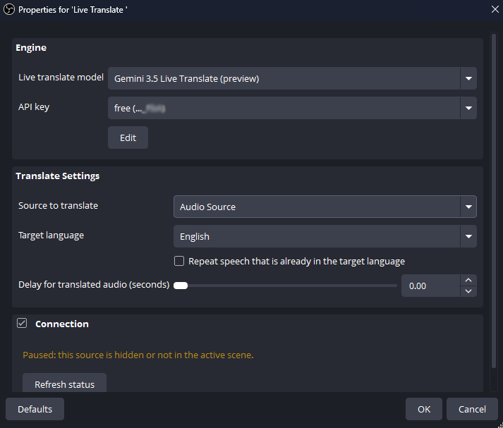
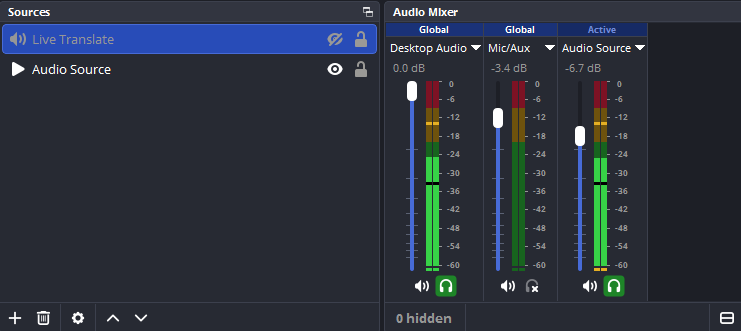
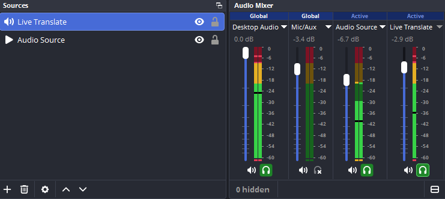

<p align="center">
  <picture>
    <source media="(prefers-color-scheme: dark)" srcset="media/icon-light.png">
    
  </picture>
</p>

# Vila GLT — Live Translate (`obs-vila-glt`)

[English](README.md) · **Srpski**

[](LICENSE)

Izvorni (native) plugin za OBS Studio koji u realnom vremenu prevodi **govor u
govor** preko Google **Gemini Live API-ja** (`gemini-3.5-live-translate-preview`).
Uzima zvuk bilo kog OBS izvora — mikrofona, browser source-a, media source-a —
šalje ga Gemini-ju i prevedeni govor pušta kao zaseban OBS audio izvor, tako da
stream ili snimak mogu da nose i originalni glas i prevod uživo. Više izvora
može da se prevodi istovremeno.

Plugin je deo **Vile**, sistema glasovnih alata i agenata zasnovanog na
Google Gemini Live modelima (native audio i live translate); *GLT* znači
*Gemini Live Translate*. On donosi Vilin prevod uživo u OBS Studio.

> **Fork i autorstvo:** `obs-vila-glt` je fork projekta
> [weisunglee/obs-live-translate](https://github.com/weisunglee/obs-live-translate)
> (*Gemini Live Translate for OBS*, v0.1.6, autor **Only26k / weisunglee**),
> preuređen za produkciju emitovanja: originalni filter za mikrofon i
> singleton arhitektura zamenjeni su nezavisnim sesijama prevoda po izvoru,
> API ključevi se čuvaju van kolekcije scena u `.env` fajlu, katalog modela i
> jezika vodi JSON, a sesije se same ponovo povezuju posle prolaznih prekida ili
> same sakriju svoj izvor u sceni posle fatalne greške.
>
> **Samo Windows.** Izdanja sadrže Windows instaler i zip; build fajlovi za
> macOS i Linux nasleđeni iz originala su zadržani, ali nisu testirani.
> Nezavisan projekat, nije povezan sa OBS Project-om ni sa Google-om niti ga
> oni podržavaju.

> [!IMPORTANT]
> **Razvoj uz pomoć AI-ja.** Znatan deo koda i dokumentacije ovog forka napisan
> je uz pomoć AI asistenata za programiranje (Claude Code, Google Antigravity),
> pod vođstvom održavaoca; kod originalnog projekta na kome se zasniva delo je
> njegovog autora. Dizajn i sve odluke su održavaočeve. Svako izdanje je
> izgrađeno, prolazi unit testove i održavalac ga testira u živom OBS okruženju
> pre objavljivanja.

**Preuzimanje:** Windows instaler i zip za ručnu instalaciju nalaze se na
[stranici Releases](https://github.com/nklisic/obs-vila-glt/releases/latest) —
izvorni kod nije potrebno preuzimati.

## Kako radi

Plugin registruje jedan OBS izvor, **Live Translate** *(audio izvor)*. Dodaj po
jedan za svaki audio izvor koji želiš da prevodiš i izaberi taj izvor kao
**Izvor koji se prevodi** (*Source to translate*) — mikrofon, browser source,
media source, bilo koji OBS izvor koji daje zvuk.

Zvuk ulaza uzima posle njegovih filtera, a pre fadera, pa stišavanje originala u
mikseru ne menja ono što Gemini čuje. Pretvara ga u 16 kHz mono 16-bit PCM, deli
na delove od 100 ms (3200 bajtova) i šalje ga Gemini-ju **neprekidno** preko TLS
WebSocket-a — uključujući tišinu u pauzama, po kojoj model prepoznaje kraj
iskaza i odmah daje prevod. Prevedeni PCM od 24 kHz koji stiže nazad ide u OBS
mikser kao zvuk ovog izvora. **Ulaz**, **API ključ**, **ciljni jezik**, opcija
**echo** i opciono **kašnjenje reprodukcije** podešavaju se u njegovim
svojstvima (Properties).

```
input audio source (mic, browser, media, …)
   │ audio capture callback (post-filter, pre-fader; original is untouched)
   ▼
[Live Translate source]
   resample 16 kHz mono → chunk → WebSocket ─▶ Gemini Live API
                                                   │ 24 kHz PCM
   event-driven push loop ◀── ring buffer ◀────────┘
   → obs_source_output_audio → OBS mixer
```

Svaki izvor ima svoj `TranslationSession` — WebSocket vezu (sa ponovnim
povezivanjem i backoff-om) i ulazne/izlazne audio bafere — pa više izvora može
da prevodi različite ulaze jedan pored drugog. Izlaz šalje OBS-u svaki primljeni
PCM deo sa neprekinutim vremenskim oznakama razmaknutim po trajanju, uz tempo
koji drži prednost rasporeda ograničenom (~600 ms, dovoljno da se izgladi
neujednačeno pristizanje prevoda na granicama fraza) — sat je OBS mikser.

## Kako dobiti Gemini API ključ

Plugin-u treba Google **Gemini API ključ**:

1. Prijavi se Google nalogom na **Google AI Studio**:
   <https://aistudio.google.com/apikey>.
2. Novi korisnici: kad prihvatiš uslove korišćenja, AI Studio sam napravi
   podrazumevani Google Cloud projekat i ključ. U suprotnom klikni
   **Create API key**.
3. U svojstvima bilo kog *Live Translate* izvora, u odeljku **Engine**, klikni
   **Izmeni** (*Edit*), nalepi ključ u *Novi API ključ* i klikni **Sačuvaj**.
   Lista *API ključ* ga onda prikazuje kao *podrazumevani (...xxxx)* — samo
   poslednja četiri znaka. Ključ dele svi izvori.

   Za više ključeva upiši **Naziv ključa** pre čuvanja (npr. `studio`); svaki
   izvor onda bira svoj ključ u listi *API ključ*. **Izmeni** → **Ukloni**
   briše izabrani ključ.

Napomene:

- Ključ se **ne** čuva u kolekciji scena. Upisuje se kao `GEMINI_API_KEY=...` u
  `.env` fajl u OBS config folderu (`%APPDATA%\obs-studio\.env` na Windows-u,
  `~/.config/obs-studio/.env` na Linux-u,
  `~/Library/Application Support/obs-studio/.env` na macOS-u). Nikad se ne vraća
  u svojstva i ne može se pročitati ni podesiti preko OBS WebSocket-a. Ključevi
  služe svim izvorima u svim kolekcijama scena; tabela modela imenuje promenljivu
  koju svaki model koristi, a imenovani ključevi se čuvaju kao njene varijante
  (`GEMINI_API_KEY_STUDIO=...`).
- `.env` je **običan tekstualni fajl**, isti na svim platformama — čuvaj ga kao
  fajl sa lozinkama (na Linux-u i macOS-u pravi se tako da samo ti možeš da ga
  čitaš). Možeš ga napraviti ili menjati i ručno; čita se kad se OBS pokrene.
  Ostale promenljive u fajlu ostaju netaknute.
- Ovo sprečava curenje ključa kroz deljenje scena ili preko OBS WebSocket-a; ne
  sprečava nekoga ko može da čita tvoj OBS config folder.
- Kolekcija scena koju je sačuvala starija verzija plugin-a i dalje sadrži ključ
  kao običan tekst (i u OBS-ovim `.bak` kopijama) dok se ponovo ne sačuva; pri
  učitavanju se taj ključ premešta u `.env`, ako tamo još nijedan nije sačuvan.
- Korišćenje `gemini-3.5-live-translate-preview` naplaćuje se po Google-ovom
  cenovniku; trenutne kvote i cene proveri u AI Studio-u
  ([cene](https://ai.google.dev/gemini-api/docs/pricing)).

## Stanje

Radi na **Windows-u** (jedinoj platformi na kojoj se ovaj fork gradi i testira)
sa **OBS Studio 33 ili novijim** (testirano na 33.0.1). Instalira se na mesto za
plugin-ove koje je OBS uveo u verziji 33.0, a koje starije verzije ne čitaju.
Trenutno ponašanje:

- ✅ Bilo koji audio izvor → strimovanje Gemini-ju (neprekidno, i tišina u
  pauzama), prevedeni zvuk se pušta kroz OBS mikser.
- ✅ Ponovno povezivanje posle prolaznih WebSocket prekida i ograničenja broja
  zahteva, po Google-ovim uputstvima za greške: sesija koja je radila bar 30 s
  odmah se ponovo povezuje kad pukne; ostali neuspesi (i sesija koja ponovo pukne
  ubrzo posle povezivanja) čekaju 1–16 s i odustaju posle 5 pokušaja. Greške koje
  ponovni pokušaj ne može da reši (potrošen kredit, neispravan API ključ,
  nepoznat model ili nepodržano podešavanje) zaustavljaju se odmah. API ključ i
  ciljni jezik mogu da se menjaju uživo.
- ✅ Izlaz vođen događajima, sa ograničenom prednošću rasporeda (~600 ms), koja
  izglađuje neujednačeno pristizanje prevoda na granicama fraza.
- ✅ Lista **Model za prevod uživo** (*Live translate model*), koju vodi
  [`data/models.json`](data/models.json) (vidi *Modeli i jezici*).
- ✅ Opciono **Ponovi govor koji je već na ciljnom jeziku** (*Repeat speech that
  is already in the target language*, echo, podrazumevano isključeno): kad je
  isključeno, govor koji je već na ciljnom jeziku ostaje bez prevoda; kad je
  uključeno, model ga ponavlja.
- ✅ Opciono **Kašnjenje prevedenog zvuka** (*Delay for translated audio*,
  0–30 sekundi): zadržava prevedeni zvuk, pa svaka prevedena fraza kreće kasnije
  za podešeno vreme. Original se nikad ne zadržava. Korisno samo kad kasni i
  slika.
- ✅ Krajevi rečenica se čuju do kraja — neprekidno slanje mikrofona (i tišine)
  omogućava modelu da prepozna kraj iskaza i odmah ga izgovori, umesto da ga
  drži dok ne počne sledeći.
- ✅ Jedan tok prevoda po *Live Translate* izvoru. Dodaj ih više da bi prevodio
  više ulaza istovremeno (npr. voditelja i goste na različitim jezicima); svaki
  ima svoju vezu, jezik i podešavanja. Drugi *Live Translate* izvori se ne nude
  kao ulaz, pa se prevod nikad ne prevodi ponovo.
- ✅ *Live Translate* izvor **ne može da se duplira**: kopija bi otvorila drugu,
  posebno naplaćenu sesiju za isti ulaz. *Paste (Reference)* i duplirane scene
  dele isti izvor; za drugi ulaz ili jezik dodaj novi *Live Translate* izvor
  sa **+**.
- ✅ Polje za potvrdu u odeljku **Veza** (*Connection*) ručno uključuje i
  isključuje sesiju (podrazumevano uključeno); njegova statusna linija je
  obojena po ozbiljnosti i ima dugme **Osveži status** (*Refresh status*), jer
  OBS sam ne osvežava otvorena svojstva.
- ✅ Lista *Izvor koji se prevodi* nudi izvore koji se vide u OBS Audio mikseru
  (sa stvarno aktivnim zvukom), pa se kamera kojoj je mikrofon isključen ne
  prikazuje.
- ✅ Tekstovi interfejsa su prevedeni (`data/locale`): engleski, srpski
  (latinica i ćirilica), bugarski, grčki, rumunski, mađarski, slovački, ruski,
  tajlandski i filipinski; plugin prati jezik OBS interfejsa, a bez locale
  fajlova koristi engleski. Prevodi osim engleskog i srpskog su mašinski —
  ispravke izvornih govornika su dobrodošle.
- ✅ Sakrivanje izvora ga i zaustavlja. Sesija radi samo dok je njen *Live
  Translate* izvor aktivan u programu: sakrij ga (ikonica oka ili OBS prečica za
  prikaži/sakrij) ili pređi na scenu bez njega, i veza se zatvara, pa se ništa
  ne šalje Gemini-ju. Kad ga ponovo prikažeš, povezuje se ponovo za oko sekundu.
  Obrnuto, ako se sesija zaustavi zbog fatalne greške (nema kredita/kvote,
  neispravan ključ) ili posle 5 neuspelih pokušaja povezivanja, izvor se sam
  sakrije u svakoj sceni u kojoj se nalazi, uključujući grupe (ikonica oka se
  isključi), a poruka o grešci ostaje vidljiva u njegovim svojstvima.
- ✅ Utišan (mute) ulaz se šalje kao tišina, pa utišavanje originala zaustavlja i
  njegov prevod. Stišavanje fadera ulaza ne utiče na prevod.
- ⚠️ Prevedeni zvuk kasni za govorom nekoliko sekundi — kašnjenje prevoda modela
  plus stalni bafer za izglađivanje od ~600 ms (koji se ne gomila; izmereni
  zaostatak ostaje < 50 ms). Savet: kad **snimaš**, sačekaj trenutak posle
  poslednje rečenice pre nego što zaustaviš snimanje, da se snimi i kraj
  prevoda. Na **strimove uživo** ovo ne utiče.

## Poznata ograničenja

Većina potiče od Gemini modela, koji je **preview** verzija, a ne od plugin-a.

- **Sesije traju oko 10 minuta.** Server završava svaku sesiju posle ~10 minuta;
  plugin se odmah ponovo povezuje (prekid traje delić sekunde).
- **Glas prevodioca može da se menja.** Prvih sekundi svake nove sesije glas još
  nije ustaljen, pa može malo da se promeni otprilike svakih 10 minuta. Posle
  promene govornika glas može i da zadrži pol prethodnog govornika (npr. ostane
  muški dok ponovo govori žena). Kod brzih, živahnih govornika ovo je izraženije.
- **Prevode se i pesme.** Stihovi otpevani uz muziku prevode se kao govor.
  Sakrij *Live Translate* izvor dok traju pesme.
- **Besplatni (free-tier) API ključevi** češće dobijaju prekid od servera nego
  plaćeni, a svako ponovno povezivanje počinje novu sesiju (vidi napomenu o glasu
  iznad).
- **Prekidi mreže:** pukla veza se primeti posle otprilike 10–20 s, a onda
  plugin pokušava još oko 15 s. Kraći prekid se sam oporavi; duži zaustavlja
  prevod i sakriva izvor — prikaži ga ponovo kad se mreža vrati.
- **Naplata prati vreme dok je sesija otvorena**, uključujući tišinu i muziku.
  Sakrivanje izvora zatvara sesiju i zaustavlja trošak. Trenutne cene proveri u
  [Google-ovom cenovniku](https://ai.google.dev/gemini-api/docs/pricing).
- **Browser source-ovi** se nude kao ulaz samo kad je u njihovim svojstvima
  uključeno *Control audio via OBS* — inače njihov zvuk potpuno zaobilazi OBS.
- **Desktop Audio kao ulaz** može da uhvati i sam prevod koji se monitoriše i da
  napravi petlju. Umesto njega izaberi stvarni izvor (media, browser, mikrofon).
- **Instaler nije potpisan** (code signing), pa Windows SmartScreen može da
  upozori pre pokretanja.

## Instalacija

Potreban je **OBS Studio 33 ili noviji**. Plugin ide na mesto koje OBS od
verzije 33.0 koristi za plugin-ove trećih strana
([OBS baza znanja](https://obsproject.com/kb/legacy-plugin-developer-info)):

```
C:\ProgramData\obs-studio\plugins\obs-vila-glt\obs-vila-glt.dll
C:\ProgramData\obs-studio\plugins\obs-vila-glt\data\   (models.json, locale\, icon.ico)
```

**Instaler (preporučeno):** preuzmi
`obs-vila-glt-<verzija>-windows-x64-installer.exe` sa
[stranice Releases](https://github.com/nklisic/obs-vila-glt/releases/latest) i
pokreni ga dok je OBS zatvoren. Traži administratorska prava, odbija OBS starije
od 33 i uklanja kopije koje su ranije verzije ostavile u OBS-ovom folderu
(`C:\Program Files\obs-studio\…`, „Legacy“ lokacija koju OBS 34 više neće
učitavati). Deinstalira se iz Windows *Apps*.

**Zip, ručno:** preuzmi `obs-vila-glt-<verzija>-windows-x64.zip`, zatvori OBS i
iskopiraj njegov folder `obs-vila-glt` u `C:\ProgramData\obs-studio\plugins\`.

**Nije bitno gde je OBS instaliran** — OBS čita plugin-ove trećih strana iz
sistemskog ProgramData foldera, gde god da je sam OBS. Dva posebna slučaja:

- **OBS sa Steam-a:** instaler možda neće naći OBS i pitaće *Install anyway?* —
  izaberi **Yes**; Steam-ov OBS takođe učitava plugin-ove iz ProgramData.
- **Portable OBS** ne čita ProgramData. Koristi zip i iskopiraj njegov folder
  `obs-vila-glt` u `<tvoj OBS folder>\plugins\` (napravi `plugins` ako ga nema).

**Iz sopstvenog build-a** (vidi *Build iz izvornog koda*): prevedi Inno Setup 7
skriptu sa `ISCC /Obuild_x64\installer installer\obs-vila-glt.iss`, ili, dok je
OBS zatvoren, iskopiraj `build_x64\RelWithDebInfo\obs-vila-glt.dll` u
`C:\ProgramData\obs-studio\plugins\obs-vila-glt\` i folder `data\` u
`C:\ProgramData\obs-studio\plugins\obs-vila-glt\data\`.

I sam DLL radi: interfejs je onda na engleskom, a tabela modela se uzima iz
kopije ugrađene u DLL.

> Napomena: pošto `obs-vila-glt` ima svoje ime modula (`obs-vila-glt.dll`), ne
> drži istovremeno instaliran originalni `obs-live-translate.dll`, jer oba
> registruju isti ID izvora `gemini_translated_audio_source`.

## Korišćenje

1. Dodaj **Live Translate** izvor u scenu (Izvori → **+** → *Live Translate*).

2. U njegovim svojstvima:
   - **Engine** — izaberi **Model za prevod uživo** i jednom podesi API ključ
     (**Izmeni**).
   - **Podešavanja prevoda** (*Translate Settings*) — izaberi **Izvor koji se
     prevodi** i **Ciljni jezik** (*Target language*); po želji *Ponovi govor
     koji je već na ciljnom jeziku* i *Kašnjenje prevedenog zvuka*.
   - **Veza** (*Connection*) — ostavi je uključenu. Kad se poveže, status
     glasi *Povezano* (*Connected*) (koristi **Osveži status**).

   <p align="center">
     
   </p>

3. Izvor pušta prevedeni glas. Izmiksuj ga sa originalom u OBS mikseru (npr.
   stišaj original ispod prevoda za voice-over) ili ga pošalji na zaseban track
   u *Advanced Audio Properties*.

Ponovi za svaki audio izvor koji želiš da prevodiš.

Ikonica oka u listi izvora uključuje i isključuje prevod: sakriven izvor (ili
izvor koji nije u aktivnoj sceni) je pauziran i nema otvorenu sesiju, pa se
ništa ne naplaćuje; kad ga ponovo prikažeš, poveže se za manje od sekunde.
Prevod se u Audio mikseru pojavljuje kao zaseban kanal samo dok je aktivan.

<p align="center">
  
  
</p>

## Daljinsko upravljanje (OBS WebSocket)

Podešavanja izvora su obična OBS podešavanja izvora, pa **ciljni jezik**, opciju
**echo** i **kašnjenje reprodukcije** možeš da menjaš uživo iz bilo kog OBS
WebSocket v5 klijenta (skripte, [`obs-cli`](https://github.com/muesli/obs-cli),
Advanced Scene Switcher, sopstvena aplikacija) zahtevom `SetInputSettings` —
plugin za to nema posebnu podršku niti mu treba:

```json
{ "requestType": "SetInputSettings",
  "requestData": {
    "inputName": "Live Translate",
    "inputSettings": { "target_lang": "ja" } } }
```

| podešavanje | tip | značenje |
|---|---|---|
| `input_source` | string | UUID OBS izvora koji se prevodi (prazno zaustavlja sesiju) |
| `model` | string | `id` modela iz [`data/models.json`](data/models.json) |
| `target_lang` | string | `code` jezika iz [`data/models.json`](data/models.json), ne njegov `name` — npr. `sr`, a ne `Српски (Serbian)` |
| `echo_target` | bool | ponovi govor koji je već na ciljnom jeziku |
| `playback_delay` | number | kašnjenje prevedenog zvuka u sekundama, ograničeno na 0–30 |
| `enabled` | bool | prekidač Veza: `false` zatvara sesiju, `true` ponovo povezuje |
| `api_key_name` | string | koji sačuvani ključ se koristi: ime `.env` promenljive imenovanog ključa, ili prazno za podrazumevani |

Napomene:

- `inputName` mora tačno da odgovara imenu tvog OBS izvora.
- Promena `model`, `target_lang` ili `echo_target` ponovo povezuje sesiju, pa
  očekuj kratak prekid. Promena `input_source` ili `playback_delay` ne povezuje.
- API ključ ne može ovako da se podesi ni pročita; koristi svojstva ili `.env`
  fajl.
- Ovo je **samo za upis**. Trenutni status veze (povezivanje / povezano /
  greška API ključa) nije dostupan preko WebSocket-a — `GetInputSettings` vraća
  sačuvana podešavanja, ne trenutni status.

## Modeli i jezici

Lista **Model za prevod uživo** i jezici svakog modela dolaze iz
[`data/models.json`](data/models.json). Fajl se ugrađuje u plugin pri build-u,
pa plugin radi kao jedan binarni fajl.

```json
{ "models": [ {
    "id": "gemini-3.5-live-translate-preview",
    "name": "Gemini 3.5 Live Translate (preview)",
    "provider": "gemini",
    "api_key_env": "GEMINI_API_KEY",
    "supports_echo": true,
    "languages": [ { "code": "en", "name": "English" } ]
} ] }
```

Da dodaš ili izmeniš model bez ponovnog build-a, stavi `models.json` istog
oblika u `plugin_config/obs-vila-glt/` u OBS config folderu: model sa postojećim
`id` zamenjuje ugrađeni, novi `id` se dodaje. Čita se kad se OBS pokrene.

`provider` bira protokol kojim plugin govori. Implementiran je samo `gemini`;
red sa drugim provajderom se preskače dok se taj protokol ne doda u kod.
`api_key_env` je promenljiva u `.env` fajlu koja čuva ključ tog modela.

## Build iz izvornog koda

Potrebni su CMake ≥ 3.28 i C++17 alati. Zavisnosti (nlohmann/json,
IXWebSocket + mbedTLS) preuzima CMake; libobs/obs-deps dolaze iz
`buildspec.json` na Windows-u i macOS-u, a sa sistema na Linux-u.

Upozorenja: plugin i unit testovi se grade sa `/W4` (drugde `-Wall -Wextra`) i
upozorenja se tretiraju kao greške. Kod trećih strana je izuzet — njegova
zaglavlja su uključena kao spoljna, a IXWebSocket-ovi izvorni fajlovi se
prevode bez upozorenja — pa svako upozorenje u build logu dolazi iz našeg koda i
mora da se ispravi. Na macOS-u i Linux-u ovo strože podešavanje nije testirano;
tamo flag `-DCMAKE_COMPILE_WARNING_AS_ERROR=OFF` u nastavku sprečava da
upozorenje obori build.

**Windows** (Visual Studio 2022) — pravi `build_x64\RelWithDebInfo\obs-vila-glt.dll`:

```powershell
cmake --preset windows-x64
cmake --build --preset windows-x64
```

**macOS** (Xcode 16+, universal) — pravi `build_macos/RelWithDebInfo/obs-vila-glt.plugin`:

```bash
cmake --preset macos -DCMAKE_COMPILE_WARNING_AS_ERROR=OFF
cmake --build --preset macos --target obs-vila-glt
```

**Linux** — libobs dolazi iz obsproject PPA; prvo instaliraj build zavisnosti:

```bash
sudo add-apt-repository --yes ppa:obsproject/obs-studio
sudo apt-get update
sudo apt-get install -y obs-studio libsimde-dev libmbedtls-dev cmake ninja-build pkg-config
cmake --preset ubuntu-x86_64 -DCMAKE_COMPILE_WARNING_AS_ERROR=OFF
cmake --build --preset ubuntu-x86_64 --target obs-vila-glt   # build_x86_64/obs-vila-glt.so
```

(Koraci za Windows izdanje su u [`.github/workflows/release.yaml`](.github/workflows/release.yaml);
CI ne gradi macOS ni Linux.)

## Testiranje

Koristi build folder svoje platforme (`build_x64` na Windows-u, `build_macos` na
macOS-u, `build_x86_64` na Linux-u). Na primer, na Windows-u:

```bash
# Build the libobs-free unit-test binary first
cmake --build --preset windows-x64 --target unit-tests

# Run the full unit-test suite
ctest --test-dir build_x64 --output-on-failure

# Run a single test case by name
ctest --test-dir build_x64 -R "<test case name>" --output-on-failure
```

Target `unit-tests` pokriva čistu logiku (base64, ring buffer, backoff,
konverzija zvuka, tempo/vremenske oznake izlaza, kašnjenje izlaza, rad sa
`.env`, katalog modela, pravila pokretanja i ponovnog povezivanja sesije,
politika ponovnog povezivanja, parsiranje Gemini protokola i razvrstavanje
prekida) i **ne** zahteva libobs. Kod koji dodiruje libobs (`source.cpp`,
`translation-session.*`) proverava se punim build-om plugin-a i testiranjem u
OBS-u.

## Struktura projekta

```
src/
  plugin-main.cpp        module entry; registers the source
  source.cpp             translated-audio source: input capture (resample →
                         chunk → stream) + event-driven output push loop
  translation-session.*  per-source WebSocket session + audio buffers + reconnect
  session-config.*       when a session runs / needs to reconnect
  model-catalog.*        parses/merges the model + language table
  model-store.*          loads the catalog (embedded JSON + optional overrides)
  api-key.*              API keys per provider, kept in <OBS config>/.env
  dotenv.*               minimal .env reading/editing
  live-protocol.*        build/parse Gemini Live API messages; classify disconnects
  audio-pacing.*         OutputTimestamper (contiguous, lead-bounded timestamps)
  output-delay.*         optional playback delay for the translated audio
  audio-convert.*        PCM downmix / conversion / chunking
  ring-buffer.*          bounded byte ring buffer
  backoff.*              exponential reconnect backoff
  reconnect-policy.*     when to reconnect, wait or give up after a disconnect
  base64.*
tests/                   Catch2 unit tests (one per pure module)
data/                    models.json + locale/ (en-US, sr-CS, sr-SP, bg-BG,
                         el-GR, ro-RO, hu-HU, sk-SK, ru-RU, th-TH, fil-PH)
media/                   project icon (README, installer); the OBS Sources
                         list currently shows OBS's built-in speaker icon
installer/               Inno Setup 7 script for the Windows installer
tools/build-icons.py     regenerates media/icon.png, icon-light.png, icon.ico
cmake/, CMakePresets.json, buildspec.json
```

## Tehnologije

C++17 · CMake (obs-plugintemplate) · libobs (OBS 31.1.1 SDK) · IXWebSocket (TLS
preko mbedTLS) · nlohmann/json · Catch2.

## Ključne činjenice o API-ju

- Model: `models/gemini-3.5-live-translate-preview` preko TLS WebSocket-a.
- **Ulaz** u Gemini: 16 kHz, 16-bit PCM, mono, little-endian, delovi od 100 ms.
- **Izlaz** iz Gemini-ja: 24 kHz, 16-bit PCM, mono.
- `translationConfig` prima `targetLanguageCode` (BCP-47) i
  `echoTargetLanguage`; **nema parametra za izvorni jezik** — model sam
  prepoznaje jezik govora.

## Podržani jezici

Padajuća lista **Ciljni jezik** nudi jezike koje
`gemini-3.5-live-translate-preview` podržava (prema
[zvaničnoj Live Translate dokumentaciji](https://ai.google.dev/gemini-api/docs/live-api/live-translate)),
svaki sa izvornim imenom i engleskim imenom (npr. `日本語 (Japanese)`), da ga
prepoznaju i izvorni govornici i ostali. Česti jezici — engleski, srpski, kineski,
japanski, korejski, španski, francuski, nemački, portugalski (BR), italijanski,
ruski, indonežanski, tajlandski, vijetnamski — stoje na vrhu, a ostali slede po
abecedi engleskih imena. Tačna lista i BCP-47
kodovi su u [`data/models.json`](data/models.json).

<details>
<summary>Kodovi jezika (77) — za <code>target_lang</code> koristi <code>code</code></summary>

| code | ime |
|---|---|
| `en` | English |
| `sr` | Српски (Serbian) |
| `zh` | 中文 (Chinese) |
| `ja` | 日本語 (Japanese) |
| `ko` | 한국어 (Korean) |
| `es` | Español (Spanish) |
| `fr` | Français (French) |
| `de` | Deutsch (German) |
| `pt-BR` | Português (Portuguese, BR) |
| `it` | Italiano (Italian) |
| `ru` | Русский (Russian) |
| `id` | Bahasa Indonesia (Indonesian) |
| `th` | ไทย (Thai) |
| `vi` | Tiếng Việt (Vietnamese) |
| `af` | Afrikaans |
| `ak` | Akan |
| `sq` | Shqip (Albanian) |
| `am` | አማርኛ (Amharic) |
| `ar` | العربية (Arabic) |
| `hy` | Հայերեն (Armenian) |
| `az` | Azərbaycan (Azerbaijani) |
| `eu` | Euskara (Basque) |
| `be` | Беларуская (Belarusian) |
| `bn` | বাংলা (Bengali) |
| `bg` | Български (Bulgarian) |
| `my` | မြန်မာ (Burmese) |
| `ca` | Català (Catalan) |
| `hr` | Hrvatski (Croatian) |
| `cs` | Čeština (Czech) |
| `da` | Dansk (Danish) |
| `nl` | Nederlands (Dutch) |
| `et` | Eesti (Estonian) |
| `fil` | Filipino |
| `fi` | Suomi (Finnish) |
| `gl` | Galego (Galician) |
| `ka` | ქართული (Georgian) |
| `el` | Ελληνικά (Greek) |
| `gu` | ગુજરાતી (Gujarati) |
| `ha` | Hausa |
| `he` | עברית (Hebrew) |
| `hi` | हिन्दी (Hindi) |
| `hu` | Magyar (Hungarian) |
| `is` | Íslenska (Icelandic) |
| `jv` | Basa Jawa (Javanese) |
| `kn` | ಕನ್ನಡ (Kannada) |
| `kk` | Қазақ (Kazakh) |
| `km` | ខ្មែរ (Khmer) |
| `rw` | Kinyarwanda |
| `lo` | ລາວ (Lao) |
| `lv` | Latviešu (Latvian) |
| `lt` | Lietuvių (Lithuanian) |
| `mk` | Македонски (Macedonian) |
| `ms` | Bahasa Melayu (Malay) |
| `ml` | മലയാളം (Malayalam) |
| `mr` | मराठी (Marathi) |
| `mn` | Монгол (Mongolian) |
| `ne` | नेपाली (Nepali) |
| `no` | Norsk (Norwegian) |
| `fa` | فارسی (Persian) |
| `pl` | Polski (Polish) |
| `pt-PT` | Português (Portuguese, Portugal) |
| `pa` | ਪੰਜਾਬੀ (Punjabi) |
| `ro` | Română (Romanian) |
| `sd` | سنڌي (Sindhi) |
| `si` | සිංහල (Sinhala) |
| `sk` | Slovenčina (Slovak) |
| `sl` | Slovenščina (Slovenian) |
| `su` | Basa Sunda (Sundanese) |
| `sw` | Kiswahili (Swahili) |
| `sv` | Svenska (Swedish) |
| `ta` | தமிழ் (Tamil) |
| `te` | తెలుగు (Telugu) |
| `tr` | Türkçe (Turkish) |
| `uk` | Українська (Ukrainian) |
| `ur` | اردو (Urdu) |
| `uz` | Oʻzbek (Uzbek) |
| `zu` | IsiZulu (Zulu) |

</details>

Kineski koristi kod bez pisma, **`zh`**, a ne `zh-Hant` / `zh-Hans`. Izlaz je
govor, koji nema pismo, pa kodovi sa pismom zvuče isto — a kvare echo na istom
jeziku (model ne smatra izgovoreni mandarinski tačnim poklapanjem sa ciljem
označenim pismom), dok `zh` ispravno i prevodi i ponavlja.

**Izvorni jezik se ne bira** — Gemini sam prepoznaje jezik govora, pa biraš samo
jezik *na koji* se prevodi.

## Van obima (v1)

Titlovi, prevod jednog ulaza na više jezika istovremeno i izričit izbor
izvornog jezika su van obima.

## Licenca

Licencirano pod GNU General Public License v2.0 — vidi [LICENSE](LICENSE).
To odgovara licenci OBS Studio-a, jer se plugin povezuje sa libobs-om.
